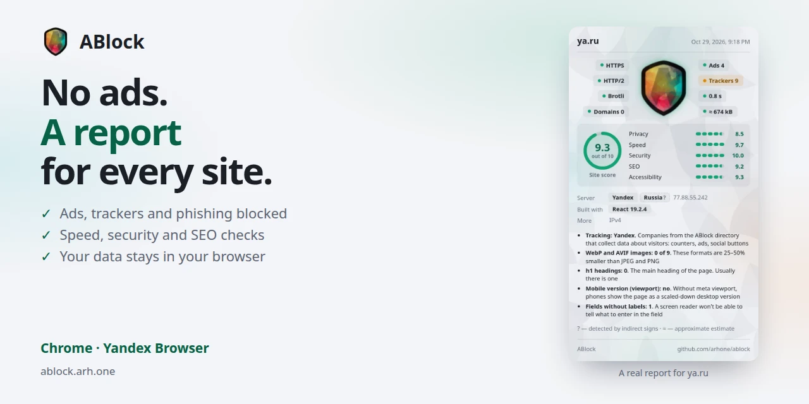

[Русский](README.md) · **English**

# ABlock — ad blocker and site checker

An ad blocker for Chrome and Yandex Browser. Check website speed, privacy, security headers and technologies in one click.

[Chrome Web Store](https://chromewebstore.google.com/detail/cmbihlcgenpbmdkipolfghkplheignfe) · [Website](https://ablock.arh.one/) · [Telegram](https://t.me/ablockinfo) · [Support](https://boosty.to/a.arh/donate)

## Features

- Blocks ads, including Google Ads, Yandex Direct and the Yandex Advertising Network, Google Analytics and Yandex Metrica trackers, and known phishing and scam sites.
- Removes ads on YouTube, VK and OK. Regional filters follow your browser's languages.
- Extended mode hides cookie pop-ups and empty ad slots. In this mode, the element picker lets you hide a selected element even when protection is off.
- Scores sites out of 10 for privacy, speed, security, SEO and accessibility. Includes a Core Web Vitals checker and checks security headers and rules for search engines and AI bots.
- Identifies technologies and tracking companies; extended mode also shows hosting and the server IP address. Shares reports as images or text, saves private site notes and lets you clear a site's data.

No “acceptable ads”. Turn protection off for an individual site if needed.
[Full guide: window, scores, permissions and extended mode (Russian)](FEATURES.md).

## Site audit details

Report sections let you expand the available causes of LCP, TTFB and CLS, scripts in long
animation frames (LoAF), observed HTTP redirects, detected IDs and settings of known services,
and robots.txt rules for four categories of AI bots. Five entries are shown initially;
use “Show N more” to see the rest. These details are neutral: they do not affect scores,
thresholds or the number of findings, and are excluded from shared text and images.

This is a snapshot of the main document and the buffer available to the browser, not a complete
page history. An element that shifted did not necessarily cause the shift. Script durations
in long animation frames do not represent total CPU time; blocking duration belongs to the
frame as a whole. Sources are attributed to owners using a local directory: a shared CDN or
an unknown address cannot reliably identify the culprit. No CPU costs are attributed to blocked requests.

Extended mode shows the tab's latest observed HTTP redirect chain. Its connection to the
document being audited is unconfirmed; JavaScript navigation and meta refresh redirects are not included.
A detected service ID or setting does not prove that code ran, data was sent or that particular
ID was blocked. GTM container contents are not inspected. AI rules describe the current URL,
individual user-agent tokens and the `*` group; they do not prove compliance with robots.txt,
use of data or consent to training.

Unavailable, unknown and incomplete information is marked separately; unknown values are not treated
as measured zeros. Collection is limited by entry counts and a cooperative processing budget of
about 20 ms for causes: elapsed time is checked between operations, but an individual browser call
cannot be interrupted. The 50 ms target for the audit's computation is a measurement guideline,
not a guaranteed deadline. Time spent waiting for the site's three files is counted separately.
If the document changes during collection, the outdated audit result is discarded.

## Privacy

The extension processes data locally and does not send it to the developer or third-party services. All data is calculated and stored in your browser;
server IPs are looked up in a bundled database. No analytics or accounts.
The hidden element list stores selectors, element types and sizes, source hosts (if third-party),
and up to 60 characters of element text in this browser only (`aBlockCustom` in `chrome.storage.local`).
Notes, settings and statistics are also stored locally. Notes are excluded from reports.
Checks use browser data and the site's own `robots.txt`, `llms.txt` and `/.well-known/security.txt`.
No third-party APIs or vulnerability scanning.

## Installation

Install from the [Chrome Web Store](https://chromewebstore.google.com/detail/cmbihlcgenpbmdkipolfghkplheignfe), also for Yandex Browser. Requires Chrome 111 or later.

From source: `git clone https://github.com/arhone/ablock.git`, open `chrome://extensions`
(`browser://extensions` in Yandex Browser), enable Developer mode, click “Load unpacked” and select `ablock/src`.

[Development: structure, rules, translations, packaging and checks (Russian)](DEVELOPMENT.md).

## Third-party data

The lists in `src/rules/lists/`, `src/rules/cosmetic/` and `src/content/cookies.css` are created by other authors and distributed under their terms.
Prebuilt rulesets come from [uBlock Origin Lite](https://github.com/uBlockOrigin/uBOL-home).

| List | Authors | License |
|---|---|---|
| [EasyList, EasyPrivacy](https://easylist.to/) | The EasyList authors | GPLv3 / CC BY-SA 3.0 |
| [uBlock filters](https://github.com/uBlockOrigin/uAssets) | Raymond Hill and uAssets contributors | GPLv3 |
| [Peter Lowe’s list](https://pgl.yoyo.org/adservers/) | Peter Lowe | Combining and publishing permitted |
| [RU AdList](https://forums.lanik.us/viewforum.php?f=102) | RU AdList authors | CC BY-SA 3.0 |
| Regional lists: EasyList Germany, AdGuard, ABPindo, IndianList and others — names and URLs in `src/rules/lists.json` | Each list's authors | GPLv3, CC BY-SA and others — see the lists' websites |
| [EasyList Cookie, uBlock Annoyances](https://easylist.to/) | The EasyList authors, Raymond Hill | GPLv3 / CC BY-SA 3.0 |

The `src/data/hosting.json` database is compiled from open [RIPE NCC](https://www.ripe.net/) data.

## Feedback

If ads get through or a site breaks, contact us on [Telegram](https://t.me/ablockinfo) or [open an issue](https://github.com/arhone/ablock/issues).
Include the page URL and, if possible, the ad request URL from the developer tools Network tab.

## Support the project

ABlock is free and has no “acceptable ads”. If you find it useful, you can support development
on [Boosty](https://boosty.to/a.arh/donate).

## License

ABlock may be freely used, modified and distributed with attribution preserved.
See [LICENSE](LICENSE) for the full text.

© 2020–2026 Алексей Арх
