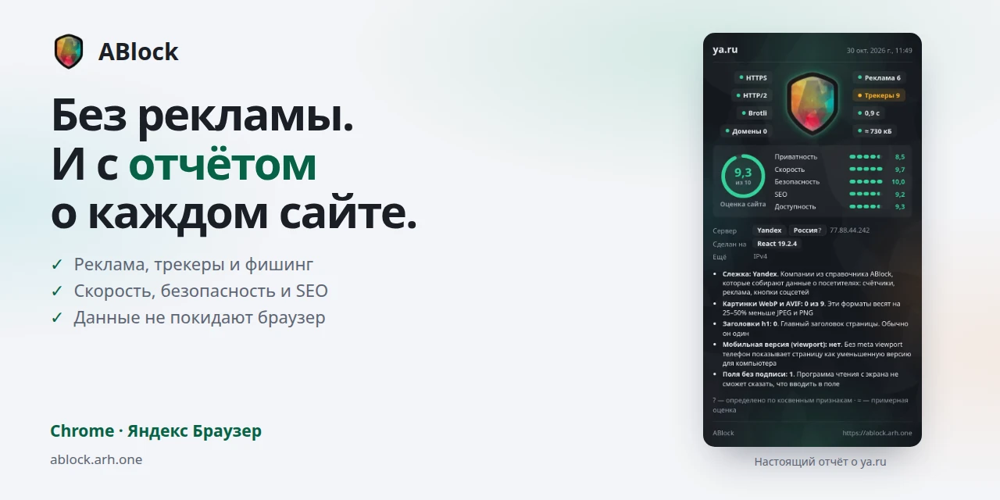

**Русский** · [English](README.en.md)

# ABlock — блокировщик рекламы и проверка сайта

Блокировщик рекламы для Chrome и Яндекс Браузера. В один клик — проверка скорости сайта, приватности, заголовков безопасности и технологий.

[Chrome Web Store](https://chromewebstore.google.com/detail/cmbihlcgenpbmdkipolfghkplheignfe) · [Сайт](https://ablock.arh.one/ru/) · [Telegram](https://t.me/ablockinfo) · [Поддержать](https://boosty.to/a.arh/donate)

## Что умеет

- Блокирует рекламу, включая Google Ads, Яндекс Директ и РСЯ, трекеры Google Analytics и Яндекс Метрики, известные фишинговые и мошеннические сайты.
- Убирает рекламу в YouTube, VK и OK. Региональные фильтры выбираются по языкам браузера.
- В расширенном режиме скрывает окна cookie и пустые места под рекламу. В этом режиме пипетка позволяет скрыть выбранный элемент даже при выключенной защите.
- Показывает оценку сайта из 10: приватность, скорость, безопасность, SEO и доступность. Проверяет Core Web Vitals, заголовки безопасности и правила для поисковиков и ИИ-ботов.
- Определяет технологии и компании-трекеры; в расширенном режиме — хостинг и IP сервера. Сохраняет отчёт картинкой или текстом, личную заметку к сайту; позволяет очистить данные сайта.

Без «допустимой рекламы». Защиту можно отключить для отдельного сайта.
[Подробнее: окно, оценка, разрешения и расширенный режим](FEATURES.md).

## Подробности проверки сайта

В разделах отчёта можно раскрыть доступные причины LCP, TTFB и CLS, скрипты в длинных
кадрах, наблюдавшиеся HTTP-переадресации, найденные ID и настройки известных сервисов,
а также правила robots.txt для четырёх категорий ИИ. Сначала показаны пять записей,
остаток раскрывается кнопкой «Ещё N». Эти подробности нейтральны: не меняют баллы,
пороги и число замечаний и не входят в текст и картинку «Поделиться».

Это снимок главного документа и доступного браузеру буфера, а не полная история страницы.
Сдвинувшийся элемент не обязательно вызвал сдвиг. Длительности скриптов в длинных кадрах
не равны полному времени процессора; блокирующее время принадлежит кадру целиком.
Владелец источника определяется по локальному справочнику: общий CDN и неизвестный адрес
не позволяют надёжно назвать виновника. Заблокированным запросам не приписываются затраты CPU.

В расширенном режиме показана последняя наблюдавшаяся HTTP-цепочка вкладки. Её связь
с документом отчёта не подтверждена; JS-переходы и meta-refresh не учитываются.
Найденный ID или настройка сервиса не доказывают выполнение кода, передачу данных
или блокировку именно этого ID. Содержимое контейнеров GTM не раскрывается.
Правила ИИ описывают текущий адрес, отдельные токены и группу `*`; они не доказывают
соблюдение robots.txt, использование данных или согласие на обучение.

Недоступные, неизвестные и неполные сведения отмечаются отдельно; неизвестное не считается
измеренным нулём. Сбор ограничен числом записей и кооперативным бюджетом обработки причин
около 20 мс: время проверяется между операциями, отдельный вызов браузера нельзя прервать.
50 мс вычислительной части аудита — ориентир измерений, а не гарантированный срок.
Ожидание трёх файлов сайта учитывается отдельно. При смене документа во время сбора
устаревший результат проверки отбрасывается.

## Приватность

Расширение обрабатывает данные локально и не отправляет их разработчику или сторонним сервисам. Все данные считаются и хранятся в браузере,
IP сервера ищется по базе внутри расширения. Нет аналитики и аккаунтов.
Для списка скрытого сохраняются селектор, вид и размер элемента, хост источника (если он сторонний)
и до 60 знаков текста элемента — только в этом браузере (`aBlockCustom` в `chrome.storage.local`).
Заметки, настройки и статистика также хранятся локально. Заметки не попадают в отчёт.
Проверка использует данные браузера и файлы самого сайта: `robots.txt`, `llms.txt`, `/.well-known/security.txt`.
Сторонних API и сканирования на уязвимости нет.

## Установка

Установите из [Chrome Web Store](https://chromewebstore.google.com/detail/cmbihlcgenpbmdkipolfghkplheignfe) — в том числе в Яндекс Браузер. Требуется Chrome 111 или новее.

Из исходников: `git clone https://github.com/arhone/ablock.git`, откройте `chrome://extensions`
(в Яндекс Браузере — `browser://extensions`), включите режим разработчика, нажмите «Загрузить распакованное расширение» и выберите `ablock/src`.

[Разработка: структура, правила, переводы, сборка и проверка](DEVELOPMENT.md).

## Сторонние данные

Списки в `src/rules/lists/`, `src/rules/cosmetic/` и `src/content/cookies.css` созданы другими авторами и распространяются на их условиях.
Готовые наборы правил взяты из [uBlock Origin Lite](https://github.com/uBlockOrigin/uBOL-home).

| Список | Авторы | Лицензия |
|---|---|---|
| [EasyList, EasyPrivacy](https://easylist.to/) | The EasyList authors | GPLv3 / CC BY-SA 3.0 |
| [uBlock filters](https://github.com/uBlockOrigin/uAssets) | Raymond Hill и участники uAssets | GPLv3 |
| [Peter Lowe’s list](https://pgl.yoyo.org/adservers/) | Peter Lowe | Разрешено объединять и публиковать |
| [RU AdList](https://forums.lanik.us/viewforum.php?f=102) | Авторы RU AdList | CC BY-SA 3.0 |
| Региональные списки: EasyList Germany, AdGuard, ABPindo, IndianList и другие — названия и адреса в `src/rules/lists.json` | Авторы каждого списка | GPLv3, CC BY-SA и др. — указаны на сайтах списков |
| [EasyList Cookie, uBlock Annoyances](https://easylist.to/) | The EasyList authors, Raymond Hill | GPLv3 / CC BY-SA 3.0 |

База `src/data/hosting.json` собрана по открытым данным [RIPE NCC](https://www.ripe.net/).

## Обратная связь

Если реклама не блокируется или сайт работает неправильно, напишите в [Telegram](https://t.me/ablockinfo)
или [создайте issue](https://github.com/arhone/ablock/issues). Укажите адрес страницы и, если возможно,
адрес рекламного запроса из вкладки «Сеть» инструментов разработчика.

## Поддержать проект

ABlock бесплатен и не показывает «допустимую рекламу». Если расширение вам полезно,
поддержать разработку можно на [Boosty](https://boosty.to/a.arh/donate).

## Лицензия

ABlock можно свободно использовать, изменять и распространять при сохранении указания авторства.
Полный текст — в [LICENSE](LICENSE).

© 2020–2026 Алексей Арх
