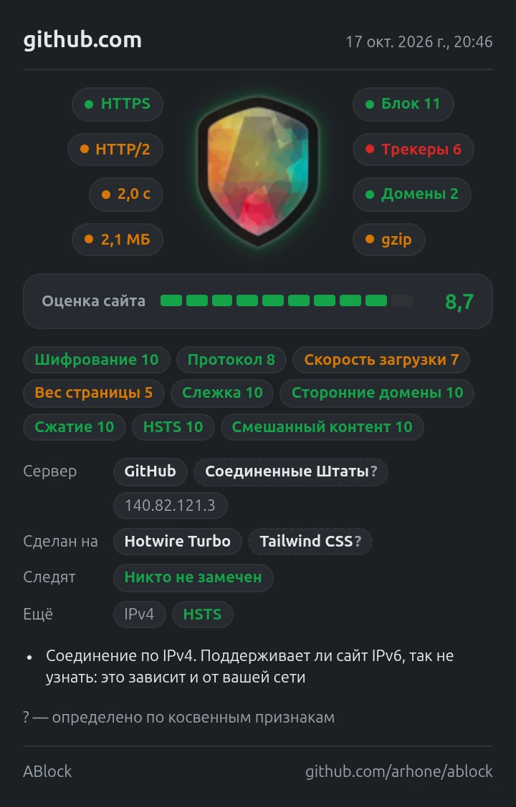

<p align="center">
    
</p>

<h1 align="center">ABlock</h1>

<p align="center">
    Блокировщик рекламы и трекеров и проверка сайта в один клик<br>
    для Chrome и Яндекс Браузера: скорость, безопасность, слежка, технологии и хостинг.
</p>

<p align="center">
    <a href="https://chromewebstore.google.com/detail/cmbihlcgenpbmdkipolfghkplheignfe">Chrome Web Store</a> ·
    <a href="https://t.me/ablockinfo">Telegram</a> ·
    <a href="https://boosty.to/a.arh/donate">Поддержать проект</a> ·
    <a href="LICENSE">Лицензия</a>
</p>

<p align="center">
    
</p>

## Возможности

ABlock делает две вещи. В фоне он блокирует рекламу, трекеры и опасные сайты — страницы открываются
быстрее, тратят меньше трафика и меньше следят за вами. А в окне расширения показывает, как устроен
открытый сайт: насколько он быстрый, безопасный, кто собирает на нём данные и на чём он сделан.
Это пригодится и обычному посетителю, и владельцу сайта или разработчику.

**Блокировка**

- Реклама: международные рекламные сети, Яндекс Директ, РСЯ, Adfox, Google Ads и другие.
- Трекеры и счётчики: Яндекс Метрика, Google Analytics, пиксели соцсетей, LiveInternet, Mail.ru.
- Реклама в плеере и ленте YouTube, VK и OK.
- Местная реклама: региональные списки (российский, немецкий, французский, китайский и ещё 35)
  включаются сами по языкам браузера.
- Известные мошеннические и фишинговые сайты.
- Окна согласия на cookie (в расширенном режиме отключаются в окне расширения).
- Пустые места под рекламу на странице (расширенный режим): селекторы тех же списков.

Исключений и «допустимой рекламы» нет. Блокирует сам браузер по готовым правилам,
поэтому расширение не замедляет загрузку страниц. Если сайт из-за блокировки работает неправильно,
защиту можно отключить только на нём.

**Проверка сайта**

- Оценка по 10-балльной шкале с разбивкой по показателям.
- Протокол, время загрузки, вес страницы, сжатие, сторонние домены.
- Компании, которые собирают данные на странице, и заблокированы ли они.
- Движок, фреймворки и библиотеки, на которых сделан сайт.
- Хостинг или CDN, IP-адрес сервера, IPv6 и HSTS.
- Отчёт о сайте картинкой или текстом — для разработчиков, подрядчиков и коллег.
- Удаление данных сайта, чтобы проверить его как новый посетитель.
- Подробный аудит: Core Web Vitals, SEO, правила для поисковиков и ИИ-ботов, доступность, заголовки безопасности.
- Заметка к сайту, которая видна только вам.

**Приватность**

Расширение ничего не собирает и никуда не отправляет. Все данные считаются и хранятся в браузере,
IP сервера ищется по базе внутри расширения.

## Окно расширения

### Сводка вокруг щита

Цвет значка: зелёный — хорошо, жёлтый — допустимо, красный — стоит исправить.

| Значок | Что показывает |
|---|---|
| HTTPS | Зашифровано ли соединение |
| HTTP/3, HTTP/2, HTTP/1.1 | Протокол сервера. HTTP/3 показывается и тогда, когда страница пришла по HTTP/2, но сервер предлагает HTTP/3 (Alt-Svc) или файлы сайта уже идут по нему — так бывает при первом заходе |
| 1,2 с | Время загрузки страницы. Если окно открыто во время загрузки, значок обновится, когда она закончится. Если какой-то файл страницы не догружается совсем, через 10 секунд показывается время готовности документа (DOMContentLoaded) |
| 2,4 МБ | Вес страницы со всеми файлами |
| Блок | Сколько запросов заблокировано на странице |
| Трекеры | Сколько из них относится к слежке |
| Домены | Сколько сторонних сайтов подгружает страница (список — при наведении) |
| Brotli, gzip | Сжата ли страница при передаче. В подсказке — сжатие текстовых файлов и список несжатых |

Щит включает и выключает защиту. Число на иконке расширения — количество заблокированных запросов на вкладке.

Галочка «Блокировать на …» под отчётом отключает защиту на одном сайте вместе с его поддоменами:
реклама и трекеры там не блокируются, скрипты расширения не запускаются. Страница при этом перезагружается.
Щит на таком сайте серый, нажатие на него возвращает защиту сайту.

Галочка «Работать в режиме инкогнито» видна, пока расширению не разрешено работать в окнах инкогнито.
Включить это расширение само не может (так устроен браузер), поэтому галочка открывает страницу ABlock
в настройках браузера, где нужный переключатель сразу на виду. В Яндекс Браузере такого переключателя на этой
странице нет, поэтому там открывается список дополнений (`browser://tune/`). После включения галочка пропадает.

Карандаш рядом со статусом добавляет к сайту заметку до 200 символов. Она видна под статусом при каждом открытии окна,
нажатие на неё открывает правку (Enter сохраняет, Esc отменяет, пустой текст удаляет заметку).
Заметки привязаны к хосту без `www.` и хранятся только в этом браузере (`aBlockNotes` в `chrome.storage.local`),
в отчёт и «Поделиться» не попадают.

### Подробности о сайте

| Строка | Что показывает |
|---|---|
| Оценка сайта | Среднее взвешенное по показателям: шифрование, протокол, скорость (LCP), сдвиги вёрстки (CLS), вес, слежка, сторонние домены, сжатие, HSTS, смешанный контент. Разбивка — при наведении. Корзина справа удаляет данные сайта (см. ниже) |
| Сервер | Хостинг или CDN по IP-адресу и страна провайдера. Кнопка справа копирует IP |
| Сделан на | Движок, фреймворки, веб-сервер и библиотеки с версиями |
| Следят | Компании, чьи счётчики и реклама подключены на странице: зелёные заблокированы, красные загрузились |
| Ещё | IPv6, HSTS, файлы без шифрования на HTTPS-странице |

Метка с пунктирной рамкой и знаком «?» определена по косвенным признакам и может быть неточной.
Знак «≈» означает оценку: браузер не сообщает размер части сторонних файлов.

**HSTS** — заголовок, который запрещает браузеру открывать сайт без HTTPS. Без него первый заход
по адресу без `https://` идёт по незашифрованному соединению.

**Сжатие** оценивается по главной странице: от неё зависит, как быстро сайт начнёт отображаться.
Балл снижается, если без сжатия передаётся больше 20% текстовых файлов (скрипты, стили, JSON, SVG).
Картинки, видео и шрифты не учитываются — они сжаты самим форматом.

**Версии ПО в заголовках** (группа «Безопасность») — сервер сообщает версии (`nginx/1.24.0`, `PHP/8.1.2`).
Это не уязвимость, но подсказка атакующему, поэтому версии лучше скрывать.

**IPv4 или IPv6** показывает, как браузер подключился к серверу. Если у вашего провайдера нет IPv6,
соединение будет по IPv4, даже когда сайт поддерживает IPv6.

### Подробнее

Раскрывающийся блок под подробностями — проверки в духе Lighthouse, но без нагрузки: только данные,
которые браузер уже собрал, и быстрые запросы к разметке страницы. Пока окно расширения закрыто, ничего не выполняется.

| Группа | Что проверяется |
|---|---|
| Скорость | Метрики Google (Core Web Vitals): TTFB, FCP, LCP, CLS, INP, файлы, блокирующие отрисовку, кэш страницы (браузер, nginx, Cloudflare, CDN) |
| SEO | Код ответа, title, description, h1, канонический адрес, Open Graph, viewport |
| Роботы и ИИ | Запрет индексации (noindex, robots.txt), наличие robots.txt и карты сайта, правила для ИИ-ботов (GPTBot, ClaudeBot, Google-Extended и др.), llms.txt |
| Вёрстка | DOCTYPE, картинки без размеров, картинки крупнее нужного, доля WebP и AVIF (в расширенном режиме — по настоящему типу файла, а не по расширению) |
| Доступность | lang, картинки без alt, поля без подписи, кнопки и ссылки без названия, main, запрет масштабирования |
| Безопасность | CSP и её слабые места (`unsafe-inline`), X-Content-Type-Options, защита от встраивания, Referrer-Policy, Permissions-Policy, COOP, версии ПО в заголовках (заголовки — в расширенном режиме); cookie сессии без HttpOnly, security.txt |

Метрики замеряются в вашем браузере на вашей сети — это реальные данные, а не эмуляция.
Пороги — как у Google: например, LCP до 2,5 с — хорошо, больше 4 с — плохо. INP появляется, когда вы
что-нибудь нажмёте на странице. В оценку сайта входят только LCP и CLS, остальное — замечания:
в картинке отчёта они выписываются списком с пояснениями.

Для групп «Роботы и ИИ» и «Безопасность» окно читает с сайта три небольших файла: `robots.txt`, `llms.txt`
и `/.well-known/security.txt`. Других запросов к сайту нет: расширение не ищет открытые служебные файлы
и не сканирует сайт на уязвимости. Если файл не удалось прочитать (сайт не ответил за 2 секунды или перенаправил
на другой домен), в строке стоит «—», а не «нет», и замечанием это не считается.

Не проверяются неиспользуемый код, ошибки консоли и контраст цветов: для этого нужен отладчик браузера
или тяжёлые вычисления.

### Проверка как у нового посетителя

Корзина рядом с оценкой удаляет всё, что браузер хранит для сайта: cookie, кэш, localStorage, IndexedDB,
service worker и другие хранилища. Затем страница перезагружается, и значки с оценкой показывают сайт
таким, каким его видит человек, открывший его впервые: без кэша, с настоящими временем загрузки, весом и сжатием.

Удаление срабатывает со второго нажатия. Вы выйдете из аккаунта на этом сайте, данные других сайтов не затрагиваются.

### Отчёт о сайте

Кнопка «Поделиться» под подробностями открывает строку иконок (названия — в подсказках):

| Действие | Результат |
|---|---|
| Копировать картинку | Картинка в буфер обмена — вставляется в любой чат или задачу |
| Сохранить картинку | PNG-файл в папку загрузок |
| Копировать текст и ссылку | Отчёт текстом и ссылка на расширение в буфер обмена |
| Поделиться | Системное меню «Поделиться» с картинкой. Есть только там, где оно есть у браузера: Windows, macOS, ChromeOS. В Linux Chrome системного меню нет, и иконка не показывается |
| Соцсети | Отчёт текстом и ссылка на расширение; в X и Weibo — сокращённо, в Reddit и Hacker News — заголовком, в Facebook и LinkedIn — только ссылка |

Соцсети подобраны по языку окна, Telegram везде первый:

| Язык | Соцсети |
|---|---|
| ru | Telegram, VK, OK, Max, X |
| kk | Telegram, WhatsApp, VK |
| uz | Telegram, WhatsApp, Facebook |
| sr, bg | Telegram, Viber, Facebook, WhatsApp |
| pl, sk | Telegram, Facebook, WhatsApp, X |
| de, fr, it | Telegram, WhatsApp, Facebook, X, LinkedIn |
| en и языки без перевода | Telegram, X, Reddit, Facebook, Hacker News |
| es, pt-BR, pt-PT, ca, hi, id, ms, ro, ar, he, sw, bn, gu, kn, ml, mr, ta, te | Telegram, WhatsApp, Facebook, X |
| tr | Telegram, WhatsApp, X, Facebook |
| vi, th, zh-TW | Telegram, Facebook, X |
| zh-CN | Telegram, Weibo, X |
| uk | Telegram, Viber, Facebook, X |
| cs, lt, lv, et | Telegram, Facebook, WhatsApp, X |
| sl, hr, el | Telegram, Viber, Facebook, WhatsApp |
| hu | Telegram, Facebook, WhatsApp, Viber |
| nl, fi | Telegram, WhatsApp, Facebook, X, LinkedIn |
| sv, no, da | Telegram, Facebook, WhatsApp, X, LinkedIn |
| fa | Telegram, WhatsApp, X |
| am | Telegram, Facebook, WhatsApp |
| fil | Telegram, Facebook, Viber, X |
| ja, ko | Telegram, X, Facebook |

Для вариантов языка (`en-GB`, `es-419`) берётся набор основного языка.

Картинка содержит домен, дату, значки, оценку по каждому показателю, подробности и пояснения
к найденным проблемам. Соцсети принимают по ссылке только текст: чтобы отправить картинку,
её пришлось бы загрузить на сервер, поэтому картинку копируйте и вставляйте в чат.

### Расширенный режим

Включается кнопкой в окне расширения и запрашивает доступ ко всем сайтам. Добавляет:

- хостинг, IP, IPv6, HSTS и заголовки сервера (по ним точнее определяются технологии сайта);
- статистику: сколько запросов заблокировано за всё время и примерно сколько трафика сэкономлено
  (три числа в `chrome.storage.local`, по сайтам ничего не хранится; на текущей странице — значок «Блок»);
- скрытие окон про cookie на страницах любых сайтов (без режима блокируются только сервисы этих окон);
- скрытие пустых мест под рекламу: скрипт на странице собирает классы и id элементов, фоновый скрипт
  подбирает к ним селекторы списков и вставляет их в страницу (сами списки на страницу не передаются);
- более точный вес тяжёлых страниц.

Выключается кнопкой внизу раскрытого блока «Подробнее» (или снятием доступа к сайтам на странице `chrome://extensions`).

## Установка

Из [Chrome Web Store](https://chromewebstore.google.com/detail/cmbihlcgenpbmdkipolfghkplheignfe).
Яндекс Браузер устанавливает расширения оттуда же.

Из исходников:

1. Склонируйте репозиторий: `git clone https://github.com/arhone/ablock.git`.
2. Откройте `chrome://extensions` (в Яндекс Браузере — `browser://extensions`).
3. Включите режим разработчика.
4. Нажмите «Загрузить распакованное расширение» и выберите папку `ablock/src`.

Требуется Chrome 111 или новее.

## Разрешения

| Разрешение | Назначение |
|---|---|
| `declarativeNetRequest` | Блокировка запросов по правилам |
| `scripting` | Скрытие баннеров на YouTube, VK, OK и pornhub, сбор данных о странице для окна |
| `activeTab` | Доступ к текущей вкладке, только когда открыто окно расширения |
| `storage` | Настройки и статистика |
| `youtube.com`, `youtube-nocookie.com`, `vk.com`, `vk.ru`, `vkvideo.ru`, `ok.ru`, `pornhub.com`, `pornhub.org` | Удаление рекламы из плеера и ленты, скрытие баннеров на этих сайтах |

Необязательные, запрашиваются при первом использовании:

| Разрешение | Назначение |
|---|---|
| `webRequest` | Расширенный режим: IP и заголовки сервера, подсчёт заблокированных запросов |
| `<all_urls>` | Расширенный режим: запросы, скрытие окон про cookie и мест под рекламу на любом сайте |
| `browsingData` | Удаление данных текущего сайта по кнопке-корзине |

## Разработка

### Структура

```
ablock/
├── src/                       расширение: ровно то, что попадает в архив для магазина
│   ├── manifest.json          описание расширения
│   ├── _locales/              переводы
│   ├── background/
│   │   └── sw.js              фоновый скрипт: настройки, наборы правил, расширенный режим, статистика
│   ├── popup/                 окно расширения
│   │   ├── popup.html
│   │   ├── popup.css
│   │   └── popup.js           значки, оценка, подробности и отчёт
│   ├── page/                  выполняются на странице по запросу окна
│   │   ├── inspect.js         определение технологий сайта
│   │   └── audit.js           метрики скорости, SEO, вёрстка, доступность
│   ├── content/               встраиваются в страницы сайтов
│   │   ├── youtube.js, .css   удаление рекламы из плеера YouTube
│   │   ├── vk.js, .css        удаление рекламы из ленты VK
│   │   ├── ok.js, .css        удаление рекламы из ленты OK
│   │   ├── pornhub.js, .css   скрытие рекламы pornhub, в том числе вставленной в обход блокировщика
│   │   ├── timing.js          расширенный режим: увеличенный буфер списка файлов страницы
│   │   ├── cosmetic.js        расширенный режим: классы и id страницы для скрытия мест под рекламу
│   │   ├── cookies.css        скрытие окон про cookie (генерируется из сторонних списков)
│   │   └── cookies-ablock.css собственные правила для окон про cookie
│   ├── rules/
│   │   ├── ads.json           собственные правила: реклама
│   │   ├── trackers.json      собственные правила: трекеры
│   │   ├── cosmetic-ablock.json собственные селекторы мест под рекламу: сайт → селекторы
│   │   ├── lists.json         языки и размер наборов для выбора региональных (генерируется)
│   │   ├── lists/             сторонние списки фильтров (генерируются)
│   │   └── cosmetic/          селекторы мест под рекламу из сторонних списков (генерируются)
│   ├── data/
│   │   ├── companies.json     компании и домены их счётчиков и рекламы
│   │   └── hosting.json       сети хостингов и CDN (генерируется)
│   └── images/                иконки и картинки окна
├── docs/
│   ├── img/                   картинки для README
│   └── store/                 описания по языкам, скриншоты и памятка для Chrome Web Store
└── tools/
    ├── update-rules.js        обновление списков фильтров
    ├── update-hosting.js      обновление базы хостингов
    └── pack.sh                сборка zip для Chrome Web Store
```

Файлы разложены по тому, где выполняются: у фонового скрипта, окна и скриптов на страницах разное окружение
(в скриптах на страницах нет `chrome.*`), и ESLint настроен по этим папкам.

### Собственные правила

Файлы `src/rules/*.json` правятся вручную:

| Файл | Что блокирует |
|---|---|
| `ads.json` | Реклама, которой нет в сторонних списках |
| `trackers.json` | Счётчики и трекеры, которых нет в сторонних списках |

Сюда попадает только то, чего нет в основных списках из `src/rules/lists/`: дубли лишь раздувают расширение.
Правило из регионального списка повторять можно: такой список включён не у всех.
Правило для одного сайта пишется в `ads.json` с условием `initiatorDomains`.

Домен вместе с поддоменами добавляется в список `requestDomains` первого правила в `ads.json`
или `trackers.json`. Отдельный адрес — новым правилом в конце файла, `id` должен быть уникальным внутри файла:

```json
{
    "id": 42,
    "action": { "type": "block" },
    "condition": { "urlFilter": "||example.com/ads/" }
}
```

Формат описан в документации [declarativeNetRequest](https://developer.chrome.com/docs/extensions/reference/api/declarativeNetRequest).

Место под рекламу, которое списки не скрывают, добавляется в `src/rules/cosmetic-ablock.json`:
адрес сайта (вместе с поддоменами) и CSS-селекторы, которые на нём скрываются.

```json
{
    "example.com": ["#ad-sidebar", ".promo-banner"]
}
```

Окна про cookie, которые не скрываются сторонним списком, добавляются селектором в `src/content/cookies-ablock.css`
(файл не перезаписывается при обновлении списков). Правила действуют на всех сайтах в расширенном режиме,
поэтому селектор должен быть достаточно точным, чтобы не задеть обычные блоки страниц.

### Списки фильтров

```sh
node tools/update-rules.js
```

Скачивает актуальные списки в `src/rules/lists/`, `src/rules/cosmetic/`, `src/content/cookies.css` и прописывает наборы правил в `src/manifest.json`.
Используются только блокирующие правила, исключения из списков не переносятся.
Повторы между списками убираются: правило или домен остаётся в первом списке, где встретился.
Список про cookie и региональные сверяются только с основными, а не друг с другом: каждый из них
может быть включён без остальных.
Если список не скачался, остаётся его прежняя версия.
В конце выводятся собственные правила из `src/rules/*.json`, которые уже есть в списках, — их можно удалить.
Только эта проверка, без скачивания: `node tools/update-rules.js --check`.

Основные списки включены всегда. Региональные (RU AdList, EasyList Germany, AdGuard Chinese и др.,
всего 38 наборов uBOL) попадают в манифест выключенными, а `src/background/sw.js` при установке и запуске браузера
включает подходящие по языку интерфейса и языкам сайтов из настроек браузера — в порядке, заданном
пользователем, пока помещаются в 30 000 правил, которые Chrome гарантирует расширению.
Основные списки с собственными правилами и списком про cookie занимают около 16 400, остальное — региональным.
Языки наборов берутся из описания uBOL, количество правил записывается в `src/rules/lists.json`.

Требуются Node.js 18+ и Google Chrome для проверки regex-правил (путь задаётся переменной `CHROME_PATH`).
После обновления поднимите версию в `src/manifest.json`.

### База хостингов

```sh
node tools/update-hosting.js
```

Скачивает из [RIPEstat](https://stat.ripe.net/) сети провайдеров из списка `PROVIDERS` в начале скрипта
и собирает `src/data/hosting.json`. Чтобы добавить провайдера, укажите его название и номера автономных систем (ASN).
Страну указывайте, только если почти все сети провайдера находятся в одной стране.

### Компании-трекеры

`src/data/companies.json` правится вручную: название компании и домены её счётчиков и рекламы.
Если компания использует общий домен, можно указать домен с путём, например `yandex.ru/ads/`.

### Переводы

Переведено на все 55 языков, которые Chrome поддерживает для расширений
([список](https://developer.chrome.com/docs/extensions/reference/api/i18n#locales)), плюс казахский и узбекский.

По умолчанию язык окна, названия и описания расширения выбирает браузер — по языку **своего интерфейса**
(не по языку сайта и не по списку языков страниц). Поиск сообщения: `pt_PT` → `pt` → `default_locale`
из `src/manifest.json` (английский). Поэтому `en_GB`, `en_AU`, `en_US` и `es_419` содержат только отличия:
ключ `locale` (формат дат и чисел) и для `es_419` — пару латиноамериканских слов; остальное берётся из `en` и `es`.

В подвале окна можно выбрать язык, не меняя язык браузера (`aBlockLang` в `chrome.storage.local`).
`chrome.i18n.getMessage` всегда отвечает на языке браузера, поэтому для выбранного языка `popup.js` сам загружает
`messages.json` по той же цепочке и подставляет `$NAME$` и `$1…$9` так же, как Chrome. Название и описание
в списке расширений и подсказка значка остаются на языке браузера. Новый перевод нужно добавить и в `LOCALES` в `popup.js`.

Ключ `locale` в каждом `messages.json` — код языка перевода (`en`, `pt-BR`), не переводится.
По нему форматируются числа, даты и названия стран, чтобы они совпадали с языком текста.
Для арабского, иврита и персидского окно и картинка отчёта пишутся справа налево (`dir="rtl"`),
поэтому отступы в `popup.css` — логические (`margin-inline-start`, а не `margin-left`).

В Chrome для компьютера нет интерфейса на белорусском, казахском, киргизском и узбекском.
В Яндекс Браузере есть казахский и узбекский, белорусского нет ни там, ни там:
сами по себе переводы `kk` и `uz` видны только в Яндекс Браузере (в Chrome — через выбор языка в окне),
а `be` не виден нигде, поэтому его нет.
Если в браузере нет названий стран на языке перевода, страна сервера показывается по-английски.

### Сборка для магазина

```sh
tools/pack.sh
```

Упаковывает содержимое `src/` в `dist/ablock-<версия>.zip`, предварительно проверив JSON-файлы.
Версия берётся из `src/manifest.json`.

### Проверка кода

```sh
npm install
npm run lint       # ESLint для src/ и tools/, Stylelint для src/**/*.css
npm run lint:fix   # автоматические исправления
```

Требуется Node.js 20.19+. `package.json` и `node_modules/` нужны только для разработки и в сборку расширения не входят.

## Сторонние данные

Списки в `src/rules/lists/`, `src/rules/cosmetic/` и `src/content/cookies.css` созданы другими авторами и распространяются на их условиях.
Готовые наборы правил взяты из [uBlock Origin Lite](https://github.com/uBlockOrigin/uBOL-home).

| Список | Авторы | Лицензия |
|---|---|---|
| [EasyList, EasyPrivacy](https://easylist.to/) | The EasyList authors | GPLv3 / CC BY-SA 3.0 |
| [uBlock filters](https://github.com/uBlockOrigin/uAssets) | Raymond Hill и участники uAssets | GPLv3 |
| [Peter Lowe’s list](https://pgl.yoyo.org/adservers/) | Peter Lowe | Разрешено объединять и публиковать |
| [RU AdList](https://forums.lanik.us/viewforum.php?f=102) | Авторы RU AdList | CC BY-SA 3.0 |
| Региональные списки: EasyList Germany, AdGuard, ABPindo, IndianList и другие — названия и адреса в `src/rules/lists.json` | Авторы каждого списка | GPLv3, CC BY-SA и др. — указаны на сайтах списков |
| [EasyList Cookie, uBlock Annoyances](https://easylist.to/) | The EasyList authors, Raymond Hill | GPLv3 / CC BY-SA 3.0 |

База `src/data/hosting.json` собрана по открытым данным [RIPE NCC](https://www.ripe.net/).

## Обратная связь

Если реклама не блокируется или сайт работает неправильно, напишите в [Telegram](https://t.me/ablockinfo)
или [создайте issue](https://github.com/arhone/ablock/issues). Укажите адрес страницы и, если возможно,
адрес рекламного запроса из вкладки «Сеть» инструментов разработчика.

## Поддержать проект

ABlock бесплатен и не показывает «допустимую рекламу». Если расширение вам полезно,
поддержать разработку можно на [Boosty](https://boosty.to/a.arh/donate).

## Лицензия

ABlock можно свободно использовать, изменять и распространять при сохранении указания авторства.
Полный текст — в [LICENSE](LICENSE).

© 2021–2026 Алексей Арх
